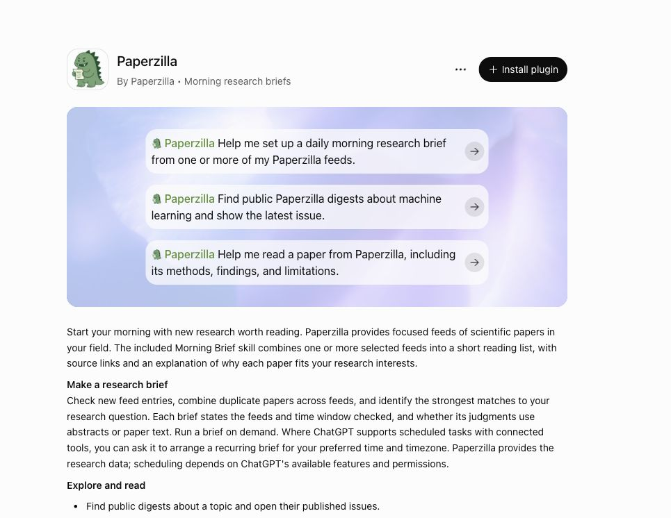
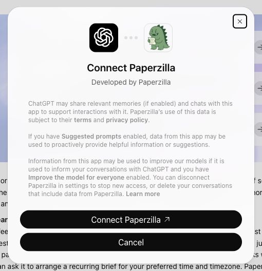
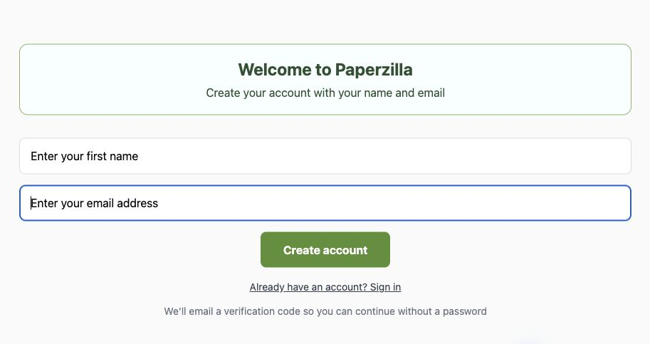
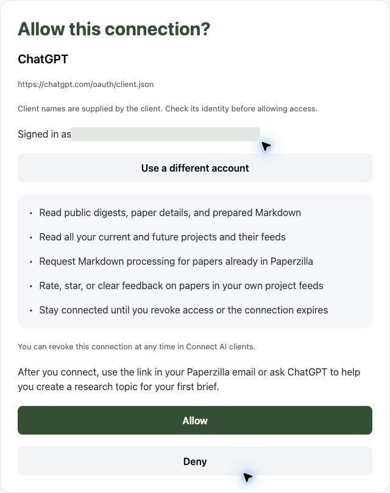
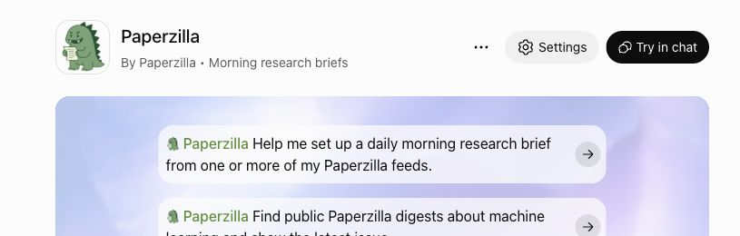
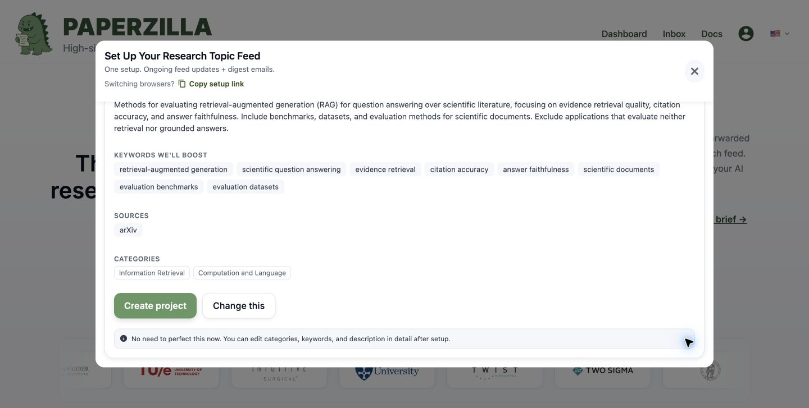
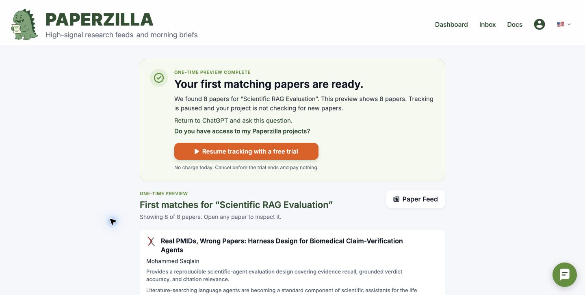
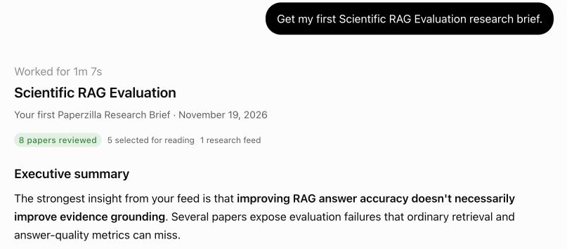

import { AiAgents } from '/es/snippets/ai-agents.mdx';

<AiAgents path="/es/guides/chatgpt-codex-briefs" />

Conecta Paperzilla y obtén tu primer resumen de investigación a partir de un proyecto que siga tu tema. Si ya conectaste Paperzilla, [elige o crea un tema de investigación](#choose-or-create-a-research-topic). Si usas Codex, ve a [Usa Paperzilla en Codex](#use-paperzilla-in-codex).

## Guía paso a paso en ChatGPT {#chatgpt-walkthrough}

### Instala el plugin de Paperzilla {#install-the-paperzilla-plugin}

Abre **Plugins** en ChatGPT y busca **Paperzilla**, o abre directamente la [ficha del plugin de Paperzilla](https://chatgpt.com/plugins/plugin_asdk_app_6ae8647a41148191ba7794dd2f6e979e). Selecciona **Install plugin**.

<Frame caption="Selecciona Install plugin en la ficha de Paperzilla.">
  
</Frame>

El acceso al plugin y las opciones disponibles dependen de tu cuenta de OpenAI y de la configuración de tu espacio de trabajo. [Guía de plugins de OpenAI](https://help.openai.com/en/articles/20001256-plugins-in-chatgpt)

### Inicia sesión y revisa el acceso {#sign-in-and-review-access}

Cuando ChatGPT te pida que conectes Paperzilla, selecciona **Connect Paperzilla**. Si cerraste el aviso, vuelve a abrir Paperzilla en **Settings → Plugins** para conectarlo.

<Frame caption="Selecciona Connect Paperzilla para continuar.">
  
</Frame>

Inicia sesión con la cuenta de Paperzilla a la que pertenecen tus proyectos. Si es la primera vez que usas Paperzilla, selecciona **Create a free account** e introduce tu nombre y tu correo electrónico.

<Frame caption="Si es la primera vez que usas Paperzilla, crea una cuenta.">
  
</Frame>

Si Paperzilla te envía un código de seis dígitos por correo, introdúcelo en la ventana de Paperzilla para continuar.

<Frame caption="Introduce el código que recibiste por correo de Paperzilla.">
  
</Frame>

En **Allow this connection?**, comprueba la cuenta y revisa los permisos solicitados. Si necesitas cambiar de cuenta, selecciona **Use a different account**. Para conectar, selecciona **Allow**. Si no ves el botón **Allow**, desplázate hacia abajo.

<Frame caption="Revisa la cuenta y los permisos y selecciona Allow para conectar.">
  
</Frame>

### Abre Paperzilla en un chat {#open-paperzilla-in-a-chat}

De vuelta en ChatGPT, selecciona **Try in chat** para abrir un chat con Paperzilla. Si quieres usar un chat existente, elige **Paperzilla** en el menú **+** junto al cuadro de mensaje o selecciónalo con **@**.

<Frame caption="Selecciona Try in chat para empezar una conversación con Paperzilla.">
  
</Frame>

## Elige o crea un tema de investigación {#choose-or-create-a-research-topic}

### Usa un proyecto existente {#use-an-existing-project}

Pide **«Usa Paperzilla para mostrarme mis proyectos»**. Elige el proyecto que quieras usar. También puedes buscar su nombre en tu [panel de Paperzilla](https://paperzilla.ai/dashboard). Después, [pide tu primer resumen](#ask-for-your-first-brief).

### Crea un tema de investigación {#create-a-research-topic}

1. Usa el enlace de configuración que te dé tu agente. En ChatGPT, también puedes abrir el [chat de configuración de Paperzilla](https://paperzilla.ai/digests/new?briefAgent=chatgpt) o usar **Create my research topic** en el correo de confirmación de la conexión. Usa la misma cuenta de Paperzilla que conectaste.
2. Describe la investigación que quieres seguir y revisa las categorías y palabras clave sugeridas. Cuando el tema quede como quieres, selecciona **Create project**.
3. Vuelve al mismo chat cuando Paperzilla guarde tu proyecto. Puedes pedir el primer resumen allí mientras se prepara la vista previa.

<Frame caption="Revisa el tema sugerido y selecciona Create project.">
  
</Frame>

Si necesitas ayuda para describir el tema, consulta el [inicio rápido de Paperzilla](/es/quickstart).

## Pide tu primer resumen {#ask-for-your-first-brief}

Sustituye **[nombre del proyecto]** por el nombre de tu proyecto y envía este mensaje.

> Usa Paperzilla para preparar mi primer resumen de investigación del proyecto [nombre del proyecto]. Elige hasta cinco artículos de mi lista, incluye un enlace a cada uno y explica por qué es relevante para mi tema.

Si Paperzilla todavía está preparando tus primeros artículos, ChatGPT o Codex puede consultar el estado de la vista previa. Puede tardar 30 minutos o más. Paperzilla te enviará un correo cuando la vista previa esté lista. Vuelve al mismo chat y pide el resumen de nuevo. [Qué esperar de tu vista previa](/es/guides/ai-agent-briefs#preview-status)

<Frame caption="Cuando la vista previa esté lista, vuelve a ChatGPT para incluir esos artículos en tu resumen.">
  
</Frame>

Puedes usar los artículos de la vista previa en un resumen aunque el seguimiento esté en pausa. Si quieres recibir resúmenes periódicos con artículos nuevos, comprueba que el seguimiento del proyecto esté activo antes de programarlos.

<Frame caption="Un primer resumen de investigación en ChatGPT con artículos de la vista previa del proyecto.">
  
</Frame>

## Usa Paperzilla en Codex {#use-paperzilla-in-codex}

Si tu tarea de Codex ofrece **Sources → Use plugins**, selecciona **Paperzilla** y conecta tu cuenta de Paperzilla cuando se te pida. También puedes [conectar Paperzilla en Codex mediante MCP](/es/guides/codex#mcp-connection). Una vez conectado, [elige o crea un tema de investigación](#choose-or-create-a-research-topic) y [pide tu primer resumen](#ask-for-your-first-brief).

Para preparar un resumen que puedas compartir con tu equipo, consulta [Usa Codex y Microsoft Teams para preparar resúmenes de investigación](/es/guides/codex-teams-briefs).

## Si tu agente no puede ver tus proyectos {#if-your-agent-cannot-see-your-projects}

- Comprueba que **Paperzilla** esté seleccionado en el chat o en la tarea.
- Confirma que la conexión usa la cuenta de Paperzilla a la que pertenece el proyecto. Si la conexión caducó o usa otra cuenta, vuelve a conectarte desde el plugin e inténtalo de nuevo.

Si tu espacio de trabajo usa conectores personalizados, consulta [Añade Paperzilla directamente en ChatGPT](/es/guides/mcp#chatgpt).
