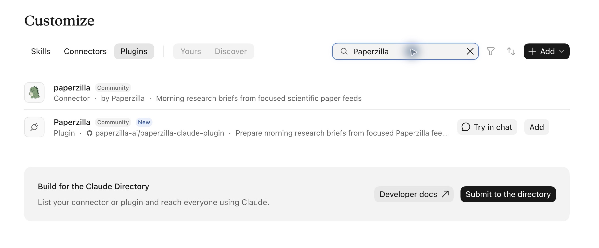
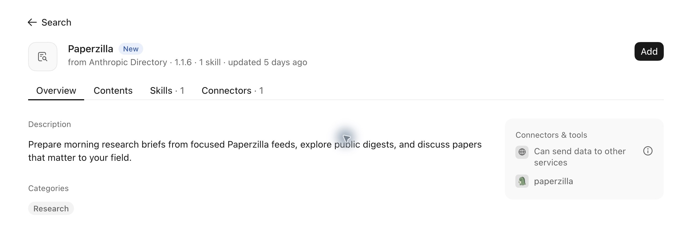
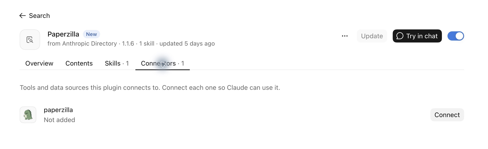
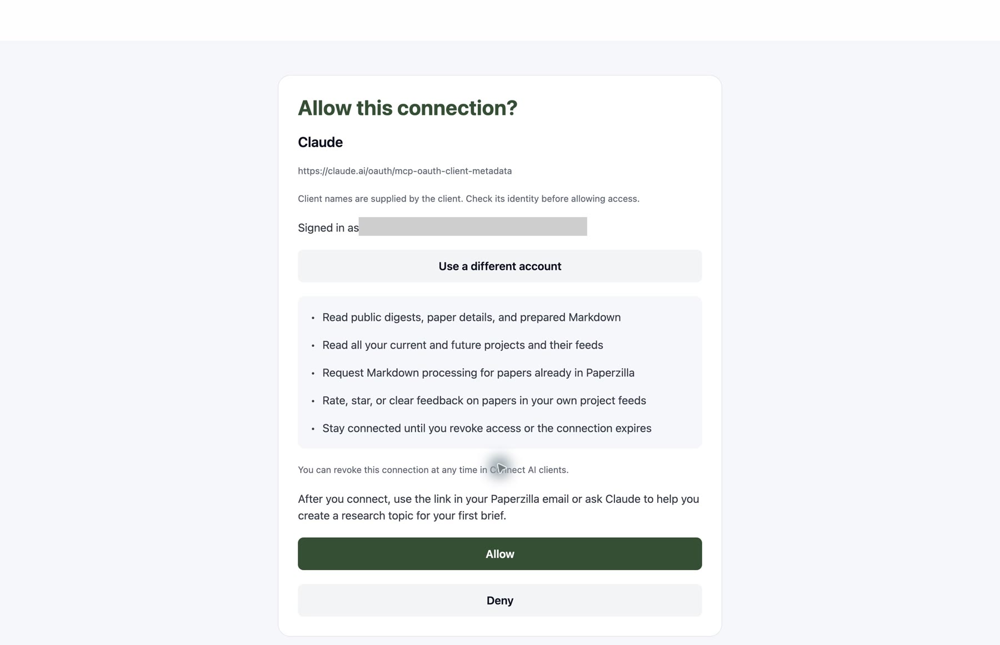
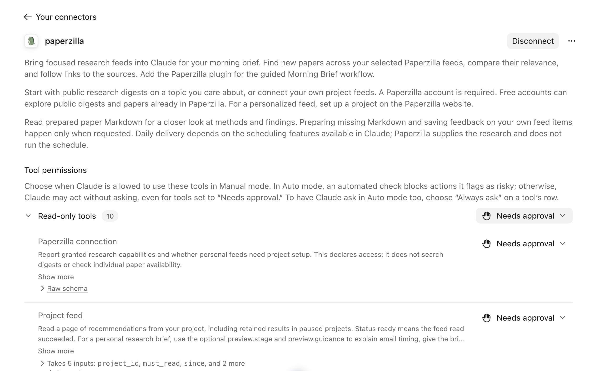
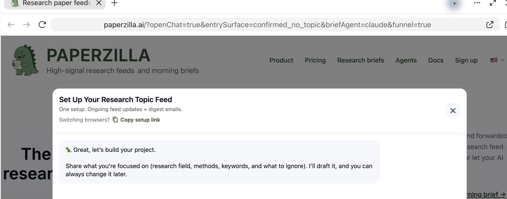
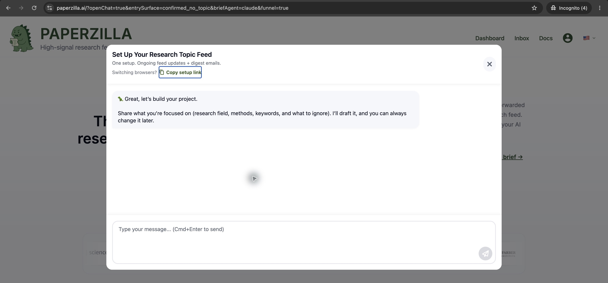
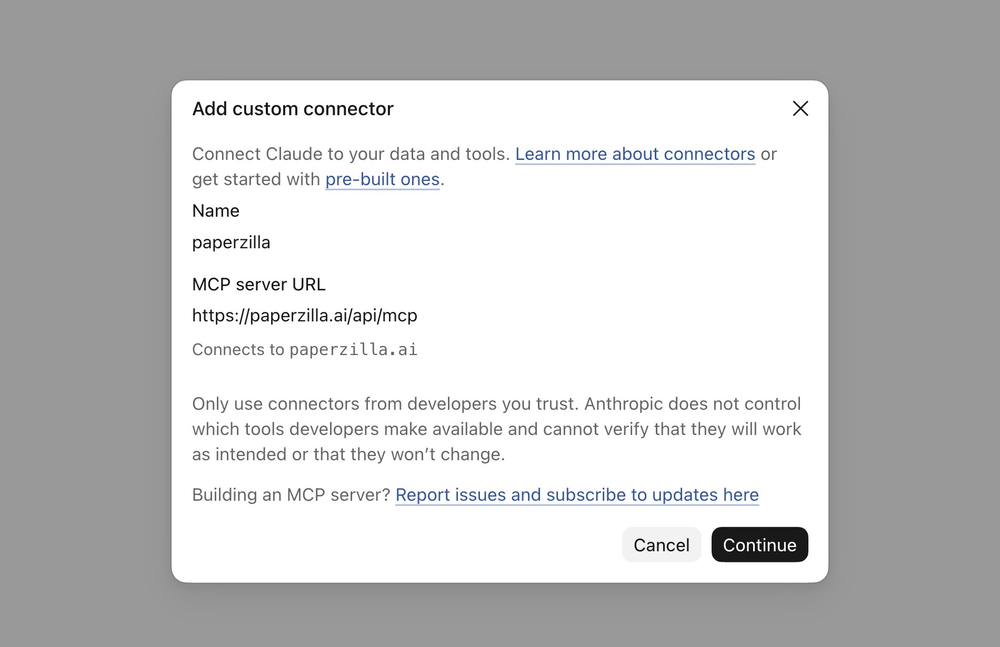
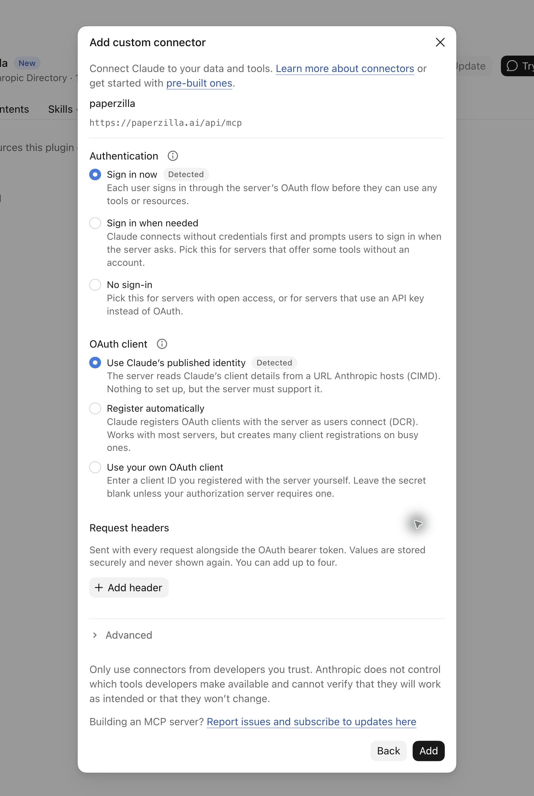

import { AiAgents } from '/es/snippets/ai-agents.mdx';

<AiAgents path="/es/guides/claude" />

Un resumen de investigación personalizado usa los artículos de un proyecto de Paperzilla que sigue tu tema. Si Paperzilla ya está conectado, [elige o crea un tema de investigación](#choose-or-create-a-research-topic) o [configura los permisos para los resúmenes automáticos](#allow-research-lookups-without-repeated-prompts).

## Guía paso a paso en Claude Desktop {#open-the-connection-setup}

El plugin incluye el conector de Paperzilla y la habilidad Morning Brief. Puedes instalarlo con un plan de pago de Claude. Si usas Claude Free, [usa el conector independiente](#use-the-standalone-connector). [Disponibilidad de plugins en Claude](https://support.claude.com/en/articles/13837440-use-plugins-in-claude)

### Instala el plugin de Paperzilla {#install-the-paperzilla-plugin}

En Claude Desktop, abre **Customize → Plugins → Discover** y busca **Paperzilla**. Elige el resultado marcado como **Plugin**.

<Frame caption="En Discover, selecciona el resultado de Paperzilla marcado como Plugin.">
  
</Frame>

En la ficha del plugin, selecciona **Add**. Si usas Claude en la web, también puedes empezar en la [ficha del plugin de Paperzilla](https://claude.ai/customize/plugins/id/5bceceee-cb5b-41a8-afa9-ce07bef3aeb1%40anthropic-plugin-directory?via=directory).

<Frame caption="Selecciona Add en la ficha del plugin de Paperzilla.">
  
</Frame>

### Conecta Paperzilla {#connect-paperzilla}

Abre el plugin instalado y selecciona la pestaña **Connectors**. Si el conector de Paperzilla muestra **Not added** o **Not connected**, selecciona **Connect**. Claude puede volver a mostrar **Connect** después de añadir el conector. Si ya muestra **Connected**, [elige o crea tu tema de investigación](#choose-or-create-a-research-topic).

<Frame caption="En la pestaña Connectors del plugin instalado, selecciona Connect.">
  
</Frame>

Si Claude abre **Add custom connector**, sigue los pasos para [elegir las opciones de autenticación](#choose-the-authentication-settings). Si el navegador muestra **Finish connecting a connector?**, selecciona **Continue connecting**.

### Inicia sesión y revisa el acceso {#sign-in-and-review-access}

1. Inicia sesión en Paperzilla. Si aún no tienes cuenta, selecciona **Create a free account** y confirma tu correo. Si ya tienes un proyecto, usa la cuenta a la que pertenece.
2. Comprueba qué cuenta de Paperzilla aparece y revisa el acceso solicitado. Selecciona **Use a different account** para cambiar de cuenta o **Allow** para terminar de conectarla.
3. Vuelve a Claude y comprueba que Paperzilla esté conectado. Después de conectarlo, puede que aparezca **Disconnect** en la página del conector.

<Frame caption="Revisa la cuenta y los permisos y selecciona Allow para conectarla.">
  
</Frame>

Si vas a automatizar tus resúmenes, [configura los permisos de las herramientas de Claude](#allow-research-lookups-without-repeated-prompts). Después, [elige o crea tu tema de investigación](#choose-or-create-a-research-topic).

Si la solicitud de conexión caduca, vuelve a seleccionar **Connect** en Claude y termina de iniciar sesión en el navegador que se abra. [Permisos de Paperzilla MCP](/es/guides/mcp)

### Configura los permisos para los resúmenes automáticos {#allow-research-lookups-without-repeated-prompts}

Después de conectar tu cuenta, abre **Customize → Connectors → Paperzilla** en Claude. En **Tool permissions**, abre el menú junto a **Read-only tools** y elige **Always allow**. Así Claude puede leer tus proyectos y feeds para preparar los resúmenes programados sin esperar a que apruebes cada consulta.

<Frame caption="En la fila Read-only tools, abre el menú que muestra Needs approval y elige Always allow.">
  
</Frame>

Deja **Prepare paper Markdown**, **Rate a paper in your feed** y **Clear a paper's feedback** en **Needs approval**. Si quieres confirmar esas acciones también en modo Auto, elige **Always ask** en la fila de cada herramienta. [Permisos de conectores en Claude](https://support.claude.com/en/articles/11176164-use-connectors-to-extend-claude-s-capabilities)

### Usa el conector independiente {#use-the-standalone-connector}

Si usas Claude Free o solo quieres las herramientas de Paperzilla, abre la [ficha del conector de Paperzilla](https://claude.ai/directory/paperzilla). Sigue las indicaciones de Claude y luego [inicia sesión y revisa el acceso](#sign-in-and-review-access). Para conectarte de forma manual, consulta [Añade un conector personalizado](#if-you-are-adding-a-custom-connector).

## Elige o crea un tema de investigación {#choose-or-create-a-research-topic}

Abre un chat en Claude. Si hace falta, abre el menú **+** junto al cuadro de mensaje, elige **Connectors** y activa **Paperzilla** para ese chat.

### Usa un proyecto existente

Elige el proyecto para tu resumen. Para ver tus opciones, pide a Claude **«Usa Paperzilla para mostrarme mis proyectos»**. También puedes buscar el nombre en tu [panel de Paperzilla](https://paperzilla.ai/dashboard). Cuando hayas elegido un proyecto, [pide a Claude tu primer resumen](#ask-claude-for-your-first-brief).

### Crea un tema de investigación {#create-a-research-topic}

1. Abre el [chat de configuración de Paperzilla](https://paperzilla.ai/digests/new?briefAgent=claude) con la misma cuenta de Paperzilla que conectaste a Claude. También puedes usar **Crear mi tema de investigación** en el correo de confirmación de la conexión de Paperzilla. Si el enlace se abre en Claude Desktop, puedes [continuar en tu navegador](#switch-browsers-from-claude-desktop).
2. Describe lo que quieres seguir. Por ejemplo, puedes pedir investigaciones sobre cómo se evalúa la fiabilidad de los agentes de IA que usan herramientas. Revisa las categorías y palabras clave propuestas.
3. Selecciona **Crear proyecto**.
4. Cuando Paperzilla guarde el proyecto, vuelve al mismo chat de Claude y [pide tu primer resumen](#ask-claude-for-your-first-brief).

### Cambia de navegador desde Claude Desktop {#switch-browsers-from-claude-desktop}

En el chat de configuración de Paperzilla, selecciona **Copy setup link**. Pega el enlace en Chrome o en el navegador que prefieras.

<Frame caption="Copia el enlace en el chat de Paperzilla abierto en Claude Desktop.">
  
</Frame>

Si se te pide que inicies sesión, usa la misma cuenta de Paperzilla que conectaste a Claude. Después de iniciar sesión, Paperzilla vuelve a abrir el chat de configuración para que puedas crear tu proyecto.

<Frame caption="Después de iniciar sesión, el chat de configuración de Paperzilla vuelve a abrirse en Chrome.">
  
</Frame>

## Pide a Claude tu primer resumen {#ask-claude-for-your-first-brief}

Usa un chat con Paperzilla activado. [Comprueba que Paperzilla esté activado en tu chat](#choose-or-create-a-research-topic)

Si instalaste el plugin, escribe `/` y selecciona la habilidad de resumen de investigación de Paperzilla. También puedes abrirla desde **Try in chat** si Claude muestra esa opción.

Sustituye **[nombre del proyecto]** por el nombre de tu proyecto y envía este mensaje.

> Usa Paperzilla para preparar mi primer resumen matutino de investigación con la lista de artículos de [nombre del proyecto]. Elige hasta cinco de los artículos añadidos más recientemente. Incluye un enlace a cada uno y explica por qué es relevante para mi tema.

Claude puede consultar el estado de la vista previa cuando le pidas un resumen. Si Paperzilla aún está buscando artículos, la búsqueda puede tardar 30 minutos o más. Paperzilla te avisa por correo cuando la vista previa está lista. Vuelve al mismo chat de Claude para recibir un resumen de los artículos de tu feed. Si la vista previa no encuentra coincidencias, pide a Claude que te ayude a ajustar el tema. [Qué esperar de tu vista previa](/es/guides/ai-agent-briefs#preview-status)

Mientras esperas, puedes probar con un resumen de ejemplo. Pide a Claude **«Usa Paperzilla para buscar un resumen periódico público sobre robótica. Elige hasta tres artículos del último número, enlaza cada uno y explica por qué merece la pena leerlo»**.

### Vuelve a tu solicitud original

Si ya habías pedido un resumen antes de conectar Paperzilla, vuelve a ese chat cuando hayas elegido o guardado un proyecto. Pide a Claude **«Paperzilla ya está conectado. Continúa con mi solicitud de resumen matutino usando la lista de artículos de [nombre del proyecto]»**.

### Programa un resumen recurrente {#schedule-recurring-brief}

[Configura los permisos de lectura de Claude](#allow-research-lookups-without-repeated-prompts) antes de programarlo. Para recibir un resumen matutino diario con artículos nuevos, mantén activo el seguimiento de tu proyecto en Paperzilla. En Claude, revisa el conector y las opciones de aprobación de la tarea guardada. Prueba **Run now** y después comprueba que una ejecución programada termine sin tu intervención. [Configura tareas recurrentes en Claude](https://support.claude.com/en/articles/13854387-schedule-recurring-tasks-in-claude-cowork)

Para recibir un resumen entre semana en un canal de Slack, sigue la [guía de Claude y Slack](/es/guides/claude-slack-briefs).

## Si vas a añadir un conector personalizado {#if-you-are-adding-a-custom-connector}

En Claude, abre **Customize → Connectors → Add → Custom → Web**. Introduce **Paperzilla** como nombre del conector y usa esta URL del servidor:

```text
https://paperzilla.ai/api/mcp
```

Continúa hasta las opciones de autenticación.

### Elige las opciones de autenticación {#choose-the-authentication-settings}

Si empezaste desde el plugin y Claude abre **Add custom connector**, comprueba la URL `https://paperzilla.ai/api/mcp` que aparece y selecciona **Continue**.

<Frame caption="Comprueba la URL de Paperzilla y selecciona Continue.">
  
</Frame>

Mantén estas opciones en el cuadro de autenticación de Claude. Es posible que estén marcadas como **Detected**.

| Sección | Opción |
| --- | --- |
| **Authentication** | **Sign in now** |
| **OAuth client** | **Use Claude’s published identity** |
| **Request headers** | Déjalo vacío; no añadas ninguna cabecera. |
| **Advanced** | Mantén los valores predeterminados. |

**Sign in now** es la opción adecuada porque Paperzilla requiere una cuenta, incluso para los digests públicos. **Use Claude’s published identity** permite que Paperzilla reconozca a Claude automáticamente. No necesitas una clave de API, un ID de cliente ni un secreto de cliente.

**Register automatically** también es compatible, pero no es necesario cuando está disponible la opción de identidad publicada. **Use your own OAuth client** no es necesario para esta configuración. Mantén **Sign in now** en lugar de **Sign in when needed** o **No sign-in**.

Comprueba que el servidor sea exactamente `https://paperzilla.ai/api/mcp` y selecciona **Add**. Si el cuadro de diálogo es más alto que la ventana, desplázate hacia abajo dentro de él para encontrar el botón. Si el conector muestra **Not connected**, vuelve a seleccionar **Connect** y luego [inicia sesión y revisa el acceso](#sign-in-and-review-access).

<Frame caption="Elige Sign in now y la identidad publicada de Claude. Desplázate hasta Add.">
  
</Frame>

Estos controles se describen en la [configuración de autenticación de Claude](https://claude.com/docs/connectors/custom/add-unlisted#choose-authentication-settings). Los nombres y la disponibilidad pueden variar según tu cuenta de Claude, tu organización o la versión de la interfaz.

## Si Claude no puede usar la conexión

| Qué ves | Siguiente paso |
| --- | --- |
| La habilidad se carga, pero Claude dice que Paperzilla no está conectado | Abre la pestaña **Connectors** del plugin y comprueba su estado. La instalación y la conexión de la cuenta son pasos separados. |
| El conector muestra **Connected**, pero las herramientas no están disponibles en el chat | Habilita Paperzilla en el menú **+ → Connectors** del chat y pide una nueva comprobación del estado de la cuenta. |
| Claude te pide que configures un proyecto | Sigue los pasos de [Crea un tema de investigación](#create-a-research-topic). Si ya tienes un proyecto, comprueba qué cuenta de Paperzilla está conectada a Claude. |
| Claude usa **Paperzilla beta** | Abre la pestaña **Connectors** del plugin de producción y conecta `https://paperzilla.ai/api/mcp`. Selecciona producción para ese chat e invoca la habilidad de producción. Beta es una conexión independiente; no proporciona acceso a producción. |
| Está conectada la cuenta de Paperzilla equivocada | Revoca esa conexión concreta en [Connect AI clients](https://paperzilla.ai/ai-connections), vuelve a conectarte desde Claude y elige **Use a different account** antes de aprobar el acceso. |
| Falta el permiso para guardar valoraciones | Actualiza las herramientas de Claude y vuelve a conectarte para revisar el consentimiento que incluye `feedback:write`. Los permisos nuevos no se añaden automáticamente a las autorizaciones existentes. |

Solo puedes reutilizar una conexión existente si coincide exactamente con la URL del servidor y la cuenta que quieres usar. Puedes conservar una conexión beta que funcione mientras añades producción. No elimines conexiones ajenas a esta configuración ni tareas programadas para resolverla.

Revoca conexiones individuales en [Connect AI clients](https://paperzilla.ai/ai-connections). Las conexiones antiguas con clave de API están retiradas; vuelve a conectarte mediante OAuth y nunca añadas credenciales a la URL del servidor.

Consulta [todas las funciones de MCP y los estados de procesamiento](/es/guides/mcp) y la [referencia de herramientas](/es/api-reference/mcp). La [documentación de plugins de Claude](https://claude.com/docs/plugins/overview#bundled-connectors) explica en qué se diferencian los conectores incluidos de las habilidades instaladas.

También puedes obtener tu primer resumen de investigación en [ChatGPT o Codex](/es/guides/chatgpt-codex-briefs), en [OpenClaw](/es/guides/openclaw-briefs) o con [otro agente de IA](/es/guides/ai-agent-briefs).
