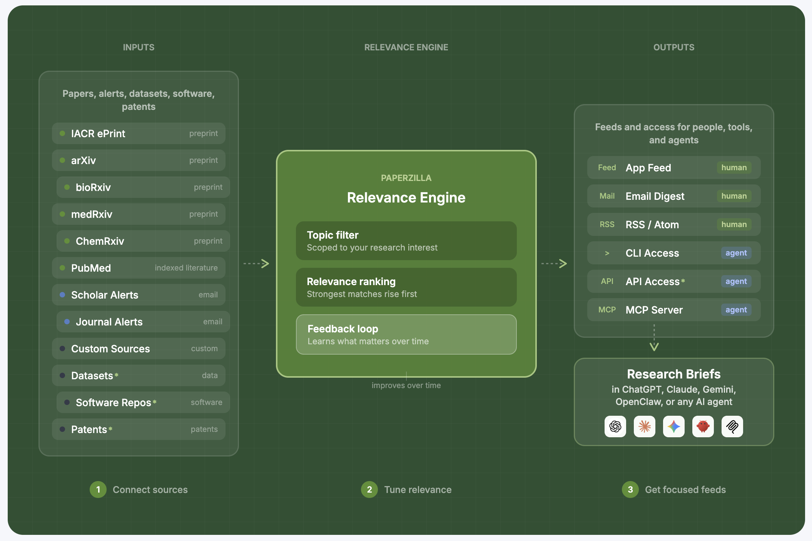

import { AiAgents } from '/es/snippets/ai-agents.mdx';

Cada día se publican artículos nuevos en servidores de preprints y revistas científicas. Revisar varios sitios y filtrar alertas lleva tiempo, y aun así es fácil pasar por alto trabajos relevantes.

Paperzilla se encarga de revisar las fuentes por ti. Busca continuamente artículos nuevos y evalúa su relevancia para el tema que describes en un proyecto. Sigue tu proyecto en la aplicación o por correo, o pídele a tu agente de IA un resumen de investigación que explique por qué vale la pena leer cada artículo.

<Frame>
  
</Frame>

El diagrama incluye funciones cuya disponibilidad depende del plan, como los conjuntos de datos, repositorios de software, patentes y el acceso a la API. Consulta los [detalles de cada plan](https://paperzilla.ai/pricing).

## Por dónde empezar

<CardGroup cols={2}>
  <Card title="Inicio rápido" icon="rocket" type="tip" href="/es/quickstart">
    Crea tu primer proyecto y encuentra artículos sobre tu tema.
  </Card>
  <Card title="Resúmenes de investigación con IA" icon="newspaper" type="tip" href="/es/guides/ai-agent-briefs">
    Elige tu agente de IA y obtén tu primer resumen de investigación de la mañana.
  </Card>
  <Card title="Proyectos" icon="folder-open" href="/es/guides/projects">
    Ajusta el tema y las palabras clave, o gestiona un proyecto existente.
  </Card>
  <Card title="Lee tus artículos" icon="book-open" href="/es/guides/feed-in-app">
    Explora tu lista, busca y valora artículos, y lee resúmenes.
  </Card>
  <Card title="Recibe novedades" icon="mail">
    Configura [resúmenes por correo](/es/guides/email-digests) o sigue tu proyecto en un [lector RSS/Atom](/es/guides/feeds).
  </Card>
  <Card title="Compartir y proyectos públicos" icon="share-2">
    [Comparte artículos y proyectos](/es/guides/sharing-and-visibility) o [explora proyectos públicos](/es/guides/public-projects).
  </Card>
  <Card title="CLI" icon="terminal" href="/es/guides/cli-getting-started">
    Instala `pz` y usa Paperzilla desde la terminal.
  </Card>
  <Card title="MCP" icon="plug" href="/es/guides/mcp">
    Conecta un cliente de IA y gestiona su acceso a Paperzilla.
  </Card>
  <Card title="Ayuda" icon="life-buoy" href="/es/guides/troubleshooting">
    Resuelve problemas comunes con proyectos, listas de artículos, correos y enlaces compartidos.
  </Card>
  <Card title="Preguntas y respuestas" icon="circle-question-mark" href="/es/answers/index">
    Encuentra una respuesta rápida a una pregunta concreta.
  </Card>
</CardGroup>

## Términos principales

- **Proyecto**: tu intención de investigación permanente (tema + intereses + palabras clave + configuración)
- **Lista de artículos**: lista actualizada continuamente con los artículos relevantes para un proyecto
- **Resumen por correo**: selección programada por correo de un proyecto
- **Resumen de investigación** — una selección de artículos nuevos de la lista de tu proyecto, con notas de tu agente de IA sobre por qué vale la pena leer cada uno

## Siguientes pasos

1. Sigue el [inicio rápido](/es/quickstart).
2. Configura tu proyecto en [Proyectos](/es/guides/projects).
3. Elige dónde prefieres leer: [lista de artículos en la aplicación](/es/guides/feed-in-app), [RSS/Atom](/es/guides/feeds), [CLI](/es/guides/cli) o [MCP](/es/guides/mcp).
4. Si usas flujos de trabajo con agentes, empieza por [Flujos de trabajo con agentes](/es/guides/agent-workflows).

<AiAgents path="/es" />
