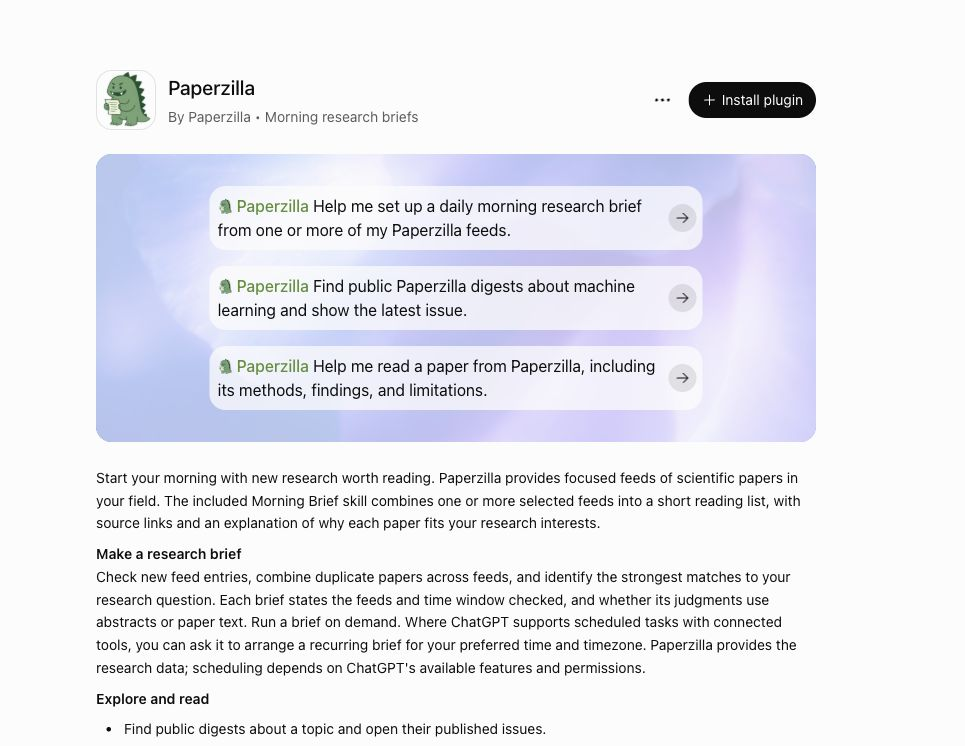
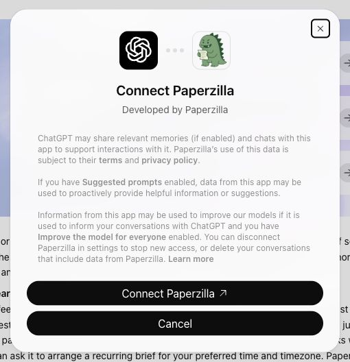
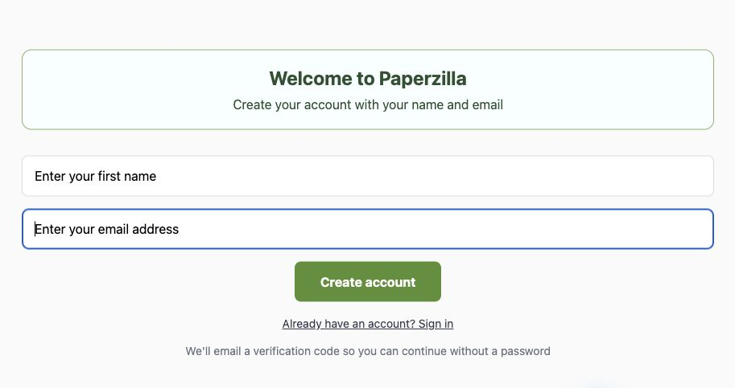
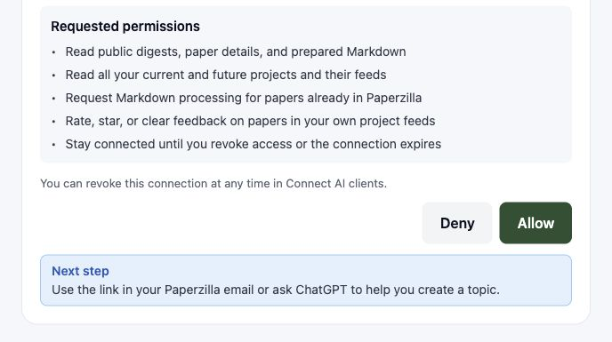
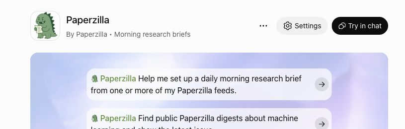
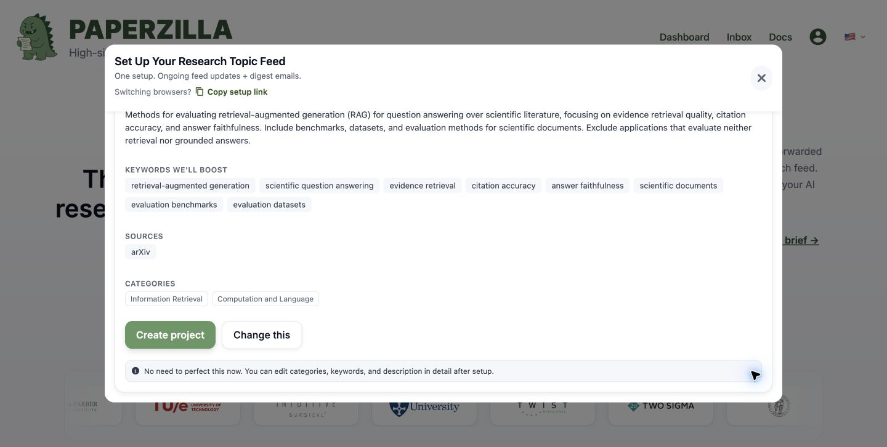
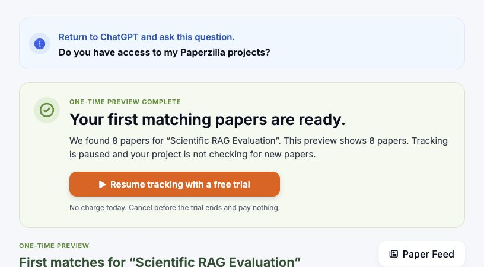
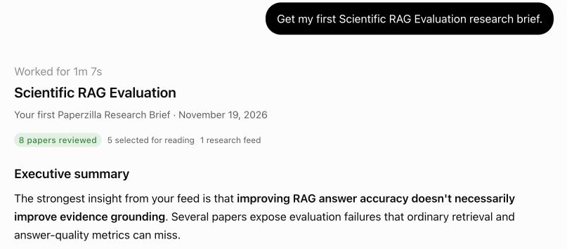

import { AiAgents } from '/snippets/ai-agents.mdx';

<AiAgents path="/guides/chatgpt-codex-briefs" />

Connect Paperzilla and get your first research brief from a project that tracks your topic. If you already connected Paperzilla, [choose or create a research topic](#choose-or-create-a-research-topic). If you’re using Codex, go to [Use Paperzilla in Codex](#use-paperzilla-in-codex).

## ChatGPT walkthrough {#chatgpt-walkthrough}

### Install the Paperzilla plugin {#install-the-paperzilla-plugin}

Open **Plugins** in ChatGPT and search for **Paperzilla**, or open the [Paperzilla plugin listing](https://chatgpt.com/plugins/plugin_asdk_app_6ae8647a41148191ba7794dd2f6e979e) directly. Select **Install plugin**.

<Frame caption="Select Install plugin on the Paperzilla listing.">
  
</Frame>

Plugin access and controls depend on your OpenAI account and workspace settings. [OpenAI’s plugin guide](https://help.openai.com/en/articles/20001256-plugins-in-chatgpt)

### Sign in and review access {#sign-in-and-review-access}

When ChatGPT asks you to connect Paperzilla, select **Connect Paperzilla**. If you dismissed the prompt, reopen Paperzilla under **Settings → Plugins** to connect.

<Frame caption="Select Connect Paperzilla to continue.">
  
</Frame>

Sign in to the Paperzilla account that owns your projects. If you’re new to Paperzilla, select **Create a free account** and enter your name and email address.

<Frame caption="Create a Paperzilla account if you’re new.">
  
</Frame>

If Paperzilla emails you a six-digit code, enter it in the Paperzilla window to continue.

<Frame caption="Enter the code from your Paperzilla email.">
  
</Frame>

On **Allow this connection?**, check the account and the requested permissions. Select **Use a different account** if you need to switch, or select **Allow** to connect. Scroll down if **Allow** is below the bottom of your window.

If you don't have a project yet, the **Next step** box shows what to do after connecting. Use the link in your Paperzilla email or ask ChatGPT to help you create your first topic.

<Frame caption="The consent screen shows your next step below Allow.">
  
</Frame>

### Open Paperzilla in a chat {#open-paperzilla-in-a-chat}

Back in ChatGPT, select **Try in chat** to open a chat with Paperzilla attached. To use an existing chat, choose **Paperzilla** from the **+** menu beside the message box or select it with **@**.

<Frame caption="Select Try in chat to start a conversation with Paperzilla.">
  
</Frame>

## Choose or create a research topic {#choose-or-create-a-research-topic}

### Use an existing project {#use-an-existing-project}

Ask **“Use Paperzilla to list my projects.”** Choose the project you want to use. You can also find its name in your [Paperzilla dashboard](https://paperzilla.ai/dashboard). Then [ask for your first brief](#ask-for-your-first-brief).

### Create a research topic {#create-a-research-topic}

1. Use the setup link your agent gives you. In ChatGPT, you can also open the [Paperzilla setup chat](https://paperzilla.ai/digests/new?briefAgent=chatgpt) or use **Create my research topic** in your connection email. Use the same Paperzilla account you connected.
2. Describe the research you want to follow and review the suggested categories and keywords. Select **Create project** when you're happy with the topic.
3. Return to the same chat after Paperzilla saves your project. You can ask for the first brief there while your preview is being prepared.

<Frame caption="Review the suggested topic and select Create project.">
  
</Frame>

For help describing a topic, see the [Paperzilla quickstart](/quickstart).

## Ask for your first brief {#ask-for-your-first-brief}

Replace **[project name]** with the name of your project and send this message.

> Use Paperzilla to give me my first research brief for my [project name] project. Pick up to five papers from my feed, link to each one, and explain why it matters for my topic.

If Paperzilla is still preparing your first papers, ChatGPT or Codex can check the preview’s progress. It can take 30 minutes or longer. Paperzilla emails you when the preview is ready. Return to the same chat and ask for the brief again. [What to expect from your preview](/guides/ai-agent-briefs#preview-status)

<Frame caption="The banner suggests a question to check that ChatGPT can see your projects.">
  
</Frame>

Your preview papers are available for a brief even if ongoing tracking is paused. If you want regular briefs with new papers, check that your project’s tracking is active before scheduling them.

<Frame caption="A first research brief in ChatGPT based on the project’s preview papers.">
  
</Frame>

## Use Paperzilla in Codex {#use-paperzilla-in-codex}

If your Codex task offers **Sources → Use plugins**, select **Paperzilla** there and connect your Paperzilla account when prompted. You can also [connect Paperzilla in Codex through MCP](/guides/codex#mcp-connection). Once connected, [choose or create a research topic](#choose-or-create-a-research-topic) and [ask for your first brief](#ask-for-your-first-brief).

For a brief you can share with your team, see [Use Codex and Microsoft Teams for research briefs](/guides/codex-teams-briefs).

## If your agent cannot see your projects {#if-your-agent-cannot-see-your-projects}

- Check that **Paperzilla** is selected in the chat or task.
- Confirm that the connection uses the Paperzilla account that owns the project. If the connection expired or uses a different account, reconnect from the plugin and try again.

If your workspace uses custom connectors, see [Add Paperzilla directly in ChatGPT](/guides/mcp#chatgpt).
