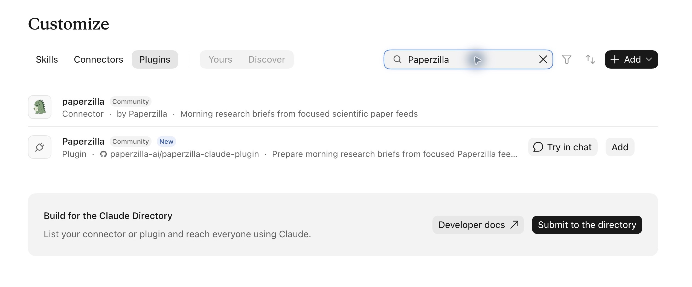
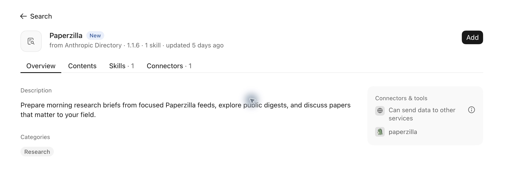
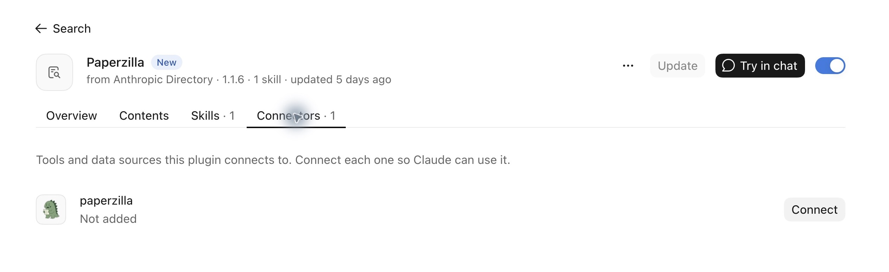
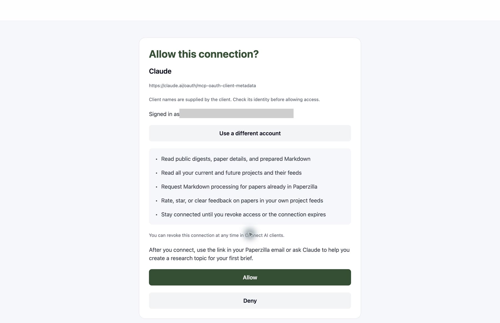
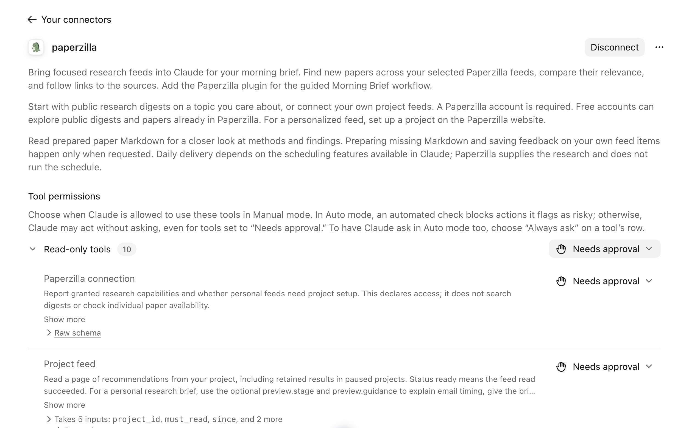
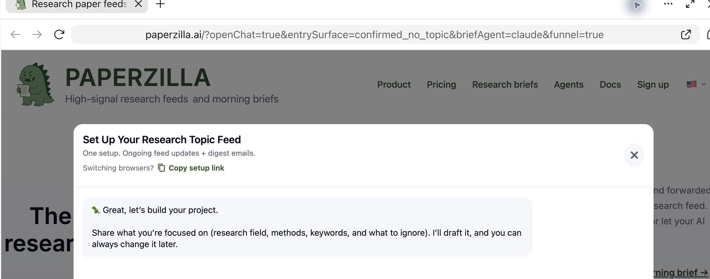
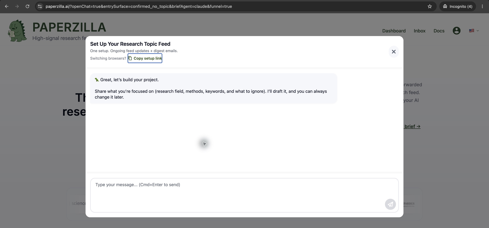
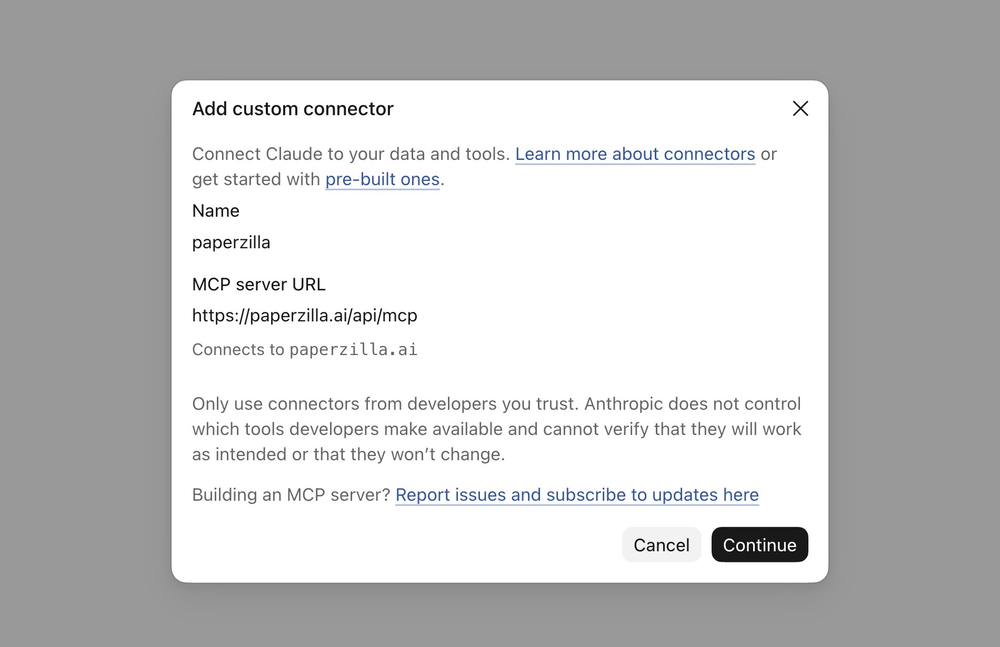
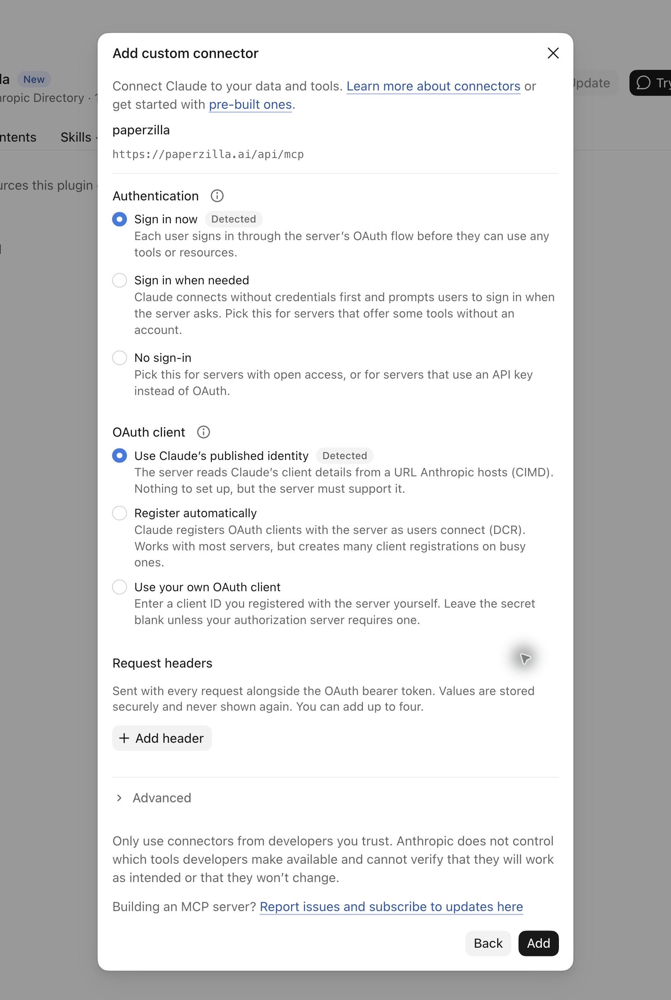

import { AiAgents } from '/snippets/ai-agents.mdx';

<AiAgents path="/guides/claude" />

A personal research brief uses the papers in a Paperzilla project, which tracks a research topic for you. If Paperzilla is already connected, [choose or create a research topic](#choose-or-create-a-research-topic) or [set permissions for automated briefs](#allow-research-lookups-without-repeated-prompts).

## Claude Desktop walkthrough {#open-the-connection-setup}

The plugin bundles the Paperzilla connector and the Morning Brief skill. You can install it on a paid Claude plan. On Claude Free, [use the standalone connector](#use-the-standalone-connector). [Claude plugin availability](https://support.claude.com/en/articles/13837440-use-plugins-in-claude)

### Install the Paperzilla plugin {#install-the-paperzilla-plugin}

In Claude Desktop, open **Customize → Plugins → Discover** and search for **Paperzilla**. Choose the result marked **Plugin**.

<Frame caption="In Discover, select the Paperzilla result labeled Plugin.">
  
</Frame>

On the plugin page, select **Add**. In Claude on the web, you can also start from the [Paperzilla plugin listing](https://claude.ai/customize/plugins/id/5bceceee-cb5b-41a8-afa9-ce07bef3aeb1%40anthropic-plugin-directory?via=directory).

<Frame caption="Select Add on the Paperzilla plugin page.">
  
</Frame>

### Connect Paperzilla {#connect-paperzilla}

Open the installed plugin and select its **Connectors** tab. If the Paperzilla connector shows **Not added** or **Not connected**, select **Connect**. Claude may show **Connect** again after adding the connector. If it shows **Connected**, [choose or create your research topic](#choose-or-create-a-research-topic).

<Frame caption="On the installed plugin's Connectors tab, select Connect.">
  
</Frame>

If Claude opens **Add custom connector**, follow [Choose the authentication settings](#choose-the-authentication-settings). If your browser asks **Finish connecting a connector?**, select **Continue connecting**.

### Sign in and review access {#sign-in-and-review-access}

1. Sign in to Paperzilla. If you’re new to Paperzilla, select **Create a free account** and confirm your email. If you already have a project, use the account that owns it.
2. Check which Paperzilla account is shown and review the requested access. Select **Use a different account** to switch accounts, or **Allow** to finish connecting.
3. Return to Claude and check that Paperzilla is connected. You may see **Disconnect** on the connector page after a successful connection.

<Frame caption="Review the account and permissions, then select Allow to connect.">
  
</Frame>

If you plan to automate your briefs, [set Claude’s tool permissions](#allow-research-lookups-without-repeated-prompts). Then [choose or create your research topic](#choose-or-create-a-research-topic).

If the connection request expires, select **Connect** again in Claude and finish sign-in in the browser that opens. [Paperzilla MCP permissions](/guides/mcp)

### Set permissions for automated briefs {#allow-research-lookups-without-repeated-prompts}

After connecting your account, open **Customize → Connectors → Paperzilla** in Claude. Under **Tool permissions**, open the dropdown next to **Read-only tools** and choose **Always allow**. This lets Claude read your projects and feeds for scheduled briefs without waiting for you to approve each lookup.

<Frame caption="On the Read-only tools row, open the dropdown shown as Needs approval and choose Always allow.">
  
</Frame>

Leave **Prepare paper Markdown**, **Rate a paper in your feed**, and **Clear a paper's feedback** on **Needs approval**. To require confirmation for those actions in Auto mode too, choose **Always ask** on each tool’s row. [Claude’s connector permissions](https://support.claude.com/en/articles/11176164-use-connectors-to-extend-claude-s-capabilities)

### Use the standalone connector {#use-the-standalone-connector}

If you use Claude Free or only want the Paperzilla tools, open the [Paperzilla connector listing](https://claude.ai/directory/paperzilla). Follow Claude’s prompts, then [sign in and review access](#sign-in-and-review-access). For manual setup, see [Add a custom connector](#if-you-are-adding-a-custom-connector).

## Choose or create a research topic {#choose-or-create-a-research-topic}

Open a Claude chat. If needed, open the **+** menu beside the message box, choose **Connectors**, and enable **Paperzilla** for that chat.

### Use an existing project

Choose the project you want to use for your brief. To see your options, ask Claude **“Use Paperzilla to list my projects.”** You can also find the project name in your [Paperzilla dashboard](https://paperzilla.ai/dashboard). Once you’ve picked a project, [ask Claude for your first brief](#ask-claude-for-your-first-brief).

### Create a research topic {#create-a-research-topic}

1. Open the [Paperzilla setup chat](https://paperzilla.ai/digests/new?briefAgent=claude) using the same Paperzilla account you connected to Claude. You can also use **Create my research topic** in your Paperzilla connection email. If the link opens inside Claude Desktop, you can [continue in your browser](#switch-browsers-from-claude-desktop).
2. Describe what you want to follow. For example, you might ask for research on how people evaluate the reliability of AI agents that use tools. Review the proposed categories and keywords.
3. Select **Create project**.
4. Once Paperzilla saves your project, return to the same Claude chat and [ask for your first brief](#ask-claude-for-your-first-brief).

### Switch browsers from Claude Desktop {#switch-browsers-from-claude-desktop}

In the Paperzilla setup chat, select **Copy setup link**. Paste the link into Chrome or your preferred browser.

<Frame caption="Copy the setup link from the Paperzilla chat opened in Claude Desktop.">
  
</Frame>

If asked to sign in, use the same Paperzilla account you connected to Claude. Paperzilla opens the setup chat after sign-in so you can create your project there.

<Frame caption="After sign-in, the Paperzilla setup chat reopens in Chrome.">
  
</Frame>

## Ask Claude for your first brief {#ask-claude-for-your-first-brief}

Use a chat with Paperzilla enabled. [Check that Paperzilla is enabled in your chat](#choose-or-create-a-research-topic)

If you installed the plugin, type `/` and select the Paperzilla research brief skill. You can also open it from **Try in chat** when Claude shows that option.

Replace **[project name]** with the name of your project and send this prompt.

> Use Paperzilla to prepare my first morning research brief from my [project name] feed. Pick up to five of the latest papers in the feed. Link each paper and explain why it matters for my research topic.

Claude can check your preview when you ask for a brief. If Paperzilla is still finding papers, it can take 30 minutes or longer. Paperzilla emails you when the preview is ready. Return to the same Claude chat to get your brief from the papers in your feed. If the preview found no matches, ask Claude to help refine your topic. [What to expect from your preview](/guides/ai-agent-briefs#preview-status)

While you wait, you can try a sample brief. Ask Claude **“Use Paperzilla to find a public digest about robotics. Pick up to three papers from its latest issue, link to each, and explain why it’s worth reading.”**

### Return to your original request

If you already asked for a brief before connecting Paperzilla, return to that chat once you’ve chosen or saved a project. Ask Claude **“Paperzilla is connected. Please continue my morning brief request using my [project name] feed.”**

### Schedule a recurring brief {#schedule-recurring-brief}

[Set Claude’s read-only permissions](#allow-research-lookups-without-repeated-prompts) before scheduling. For a daily morning brief with new papers, keep your project tracking active in Paperzilla. In Claude, check the saved task’s connector and approval settings. Try **Run now**, then check that a scheduled run succeeds while you’re away. [Claude’s recurring-task setup](https://support.claude.com/en/articles/13854387-schedule-recurring-tasks-in-claude-cowork)

For a weekday brief in a Slack channel, follow the [Claude and Slack walkthrough](/guides/claude-slack-briefs).

## If you are adding a custom connector {#if-you-are-adding-a-custom-connector}

In Claude, open **Customize → Connectors → Add → Custom → Web**. Enter **Paperzilla** as the connector name and use this server URL:

```text
https://paperzilla.ai/api/mcp
```

Continue to the authentication settings.

### Choose the authentication settings {#choose-the-authentication-settings}

If you started from the plugin and Claude opens **Add custom connector**, check the prefilled URL `https://paperzilla.ai/api/mcp` and select **Continue**.

<Frame caption="Check the Paperzilla URL and select Continue.">
  
</Frame>

Keep these choices in Claude’s authentication dialog. It may mark them as **Detected**.

| Section | Choose |
| --- | --- |
| **Authentication** | **Sign in now** |
| **OAuth client** | **Use Claude’s published identity** |
| **Request headers** | Leave empty; do not add a header. |
| **Advanced** | Keep the defaults. |

**Sign in now** is the right choice because Paperzilla requires an account, including for public digests. **Use Claude’s published identity** lets Paperzilla recognize Claude automatically. You do not need an API key, client ID, or client secret.

**Register automatically** is also supported, but is unnecessary when the published-identity option is available. **Use your own OAuth client** is not needed for this setup. Keep **Sign in now** rather than **Sign in when needed** or **No sign-in**.

Check that the server is exactly `https://paperzilla.ai/api/mcp`, then select **Add**. If the dialog is taller than your window, scroll down inside it to find the button. If the connector shows **Not connected**, select **Connect** again, then [sign in and review access](#sign-in-and-review-access).

<Frame caption="Choose Sign in now and Claude’s published identity, then scroll down to Add.">
  
</Frame>

These controls are documented in [Claude's authentication setup](https://claude.com/docs/connectors/custom/add-unlisted#choose-authentication-settings). Names and availability can vary with your Claude account, organization, or interface version.

## If Claude cannot use the connection

| What you see | Next step |
| --- | --- |
| The skill loads, but Claude says Paperzilla is not connected | Open the plugin's **Connectors** tab and check its status. Installation and account connection are separate. |
| The connector says **Connected**, but tools are unavailable in the chat | Enable Paperzilla in the chat's **+ → Connectors** menu, then ask for a fresh account-status check. |
| Claude asks you to set up a project | Follow [Create a research topic](#create-a-research-topic). If you already have a project, check which Paperzilla account Claude is connected to. |
| Claude uses **Paperzilla beta** | Open the production plugin's **Connectors** tab and connect `https://paperzilla.ai/api/mcp`. Select production for this chat and invoke the production skill. Beta is a separate connection; it does not establish production access. |
| The wrong Paperzilla account is connected | Revoke that specific connection in [Connect AI clients](https://paperzilla.ai/ai-connections), reconnect from Claude, and choose **Use a different account** before approving access. |
| Feedback permission is missing | Refresh Claude's tools and reconnect to review consent including `feedback:write`. Existing grants do not gain new permissions automatically. |

An existing connection can be reused only for the exact same server URL and intended account. You can keep a working beta connection while adding production. Do not delete unrelated connections or scheduled tasks to fix this setup.

Revoke individual connections in [Connect AI clients](https://paperzilla.ai/ai-connections). Old API-key connections are retired; reconnect through OAuth and never add credentials to the server URL.

See [all MCP capabilities and processing states](/guides/mcp) and the [tool reference](/api-reference/mcp). [Claude's plugin documentation](https://claude.com/docs/plugins/overview#bundled-connectors) explains how bundled connectors differ from installed skills.

You can also get your first research brief in [ChatGPT or Codex](/guides/chatgpt-codex-briefs), in [OpenClaw](/guides/openclaw-briefs), or with [another AI agent](/guides/ai-agent-briefs).
