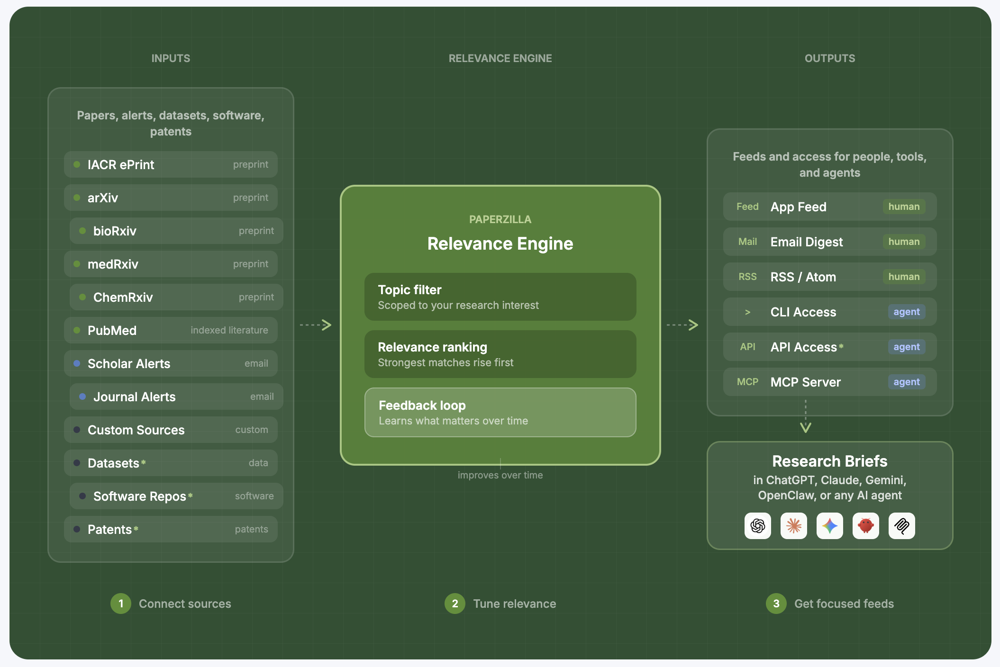

import { AiAgents } from '/snippets/ai-agents.mdx';

New papers appear every day across preprint servers and journals. Checking multiple sites and sorting through alerts takes time, and relevant work can still slip by.

Paperzilla does the scanning for you. It continuously checks its sources for new papers and matches them to the research topic you describe in a project. Follow your project in the app or by email, or ask your AI agent for a research brief that explains why each paper is worth reading.

<Frame>
  
</Frame>

The diagram includes features whose availability varies by plan, including datasets, software repositories, patents, and API access. See [plan details](https://paperzilla.ai/pricing).

## Start here

<CardGroup cols={2}>
  <Card title="Quickstart" icon="rocket" type="tip" href="/quickstart">
    Create your first project and find papers on your topic.
  </Card>
  <Card title="AI research briefs" icon="newspaper" type="tip" href="/guides/ai-agent-briefs">
    Choose your AI agent and get your first morning research brief.
  </Card>
  <Card title="Projects" icon="folder-open" href="/guides/projects">
    Tune your topic and keywords, or manage an existing project.
  </Card>
  <Card title="Read your papers" icon="book-open" href="/guides/feed-in-app">
    Browse and search your feed, rate papers, and read summaries.
  </Card>
  <Card title="Get updates" icon="mail">
    Set up [email digests](/guides/email-digests) or follow your project in an [RSS/Atom reader](/guides/feeds).
  </Card>
  <Card title="Sharing and public projects" icon="share-2">
    [Share papers and projects](/guides/sharing-and-visibility) or [browse public projects](/guides/public-projects).
  </Card>
  <Card title="CLI" icon="terminal" href="/guides/cli-getting-started">
    Install `pz` and use Paperzilla from the terminal.
  </Card>
  <Card title="MCP" icon="plug" href="/guides/mcp">
    Connect an AI client and manage its access to Paperzilla.
  </Card>
  <Card title="Help" icon="life-buoy" href="/guides/troubleshooting">
    Fix common issues with projects, feeds, email delivery, and sharing.
  </Card>
  <Card title="Questions and answers" icon="circle-question-mark" href="/answers/index">
    Find a quick answer to a specific question.
  </Card>
</CardGroup>

## Core terms

- **Project**: your standing research intent (topic + interests + keywords + settings)
- **Feed**: continuously updated list of matched papers for a project
- **Email digest**: a scheduled email selection from your project
- **Research brief** — a selection of new papers from your project feed, with notes from your AI agent on why each is worth reading

## Next steps

1. Follow the [quickstart](/quickstart).
2. Configure your project in [projects](/guides/projects).
3. Choose your preferred reading surface: [in-app feed](/guides/feed-in-app), [RSS/Atom](/guides/feeds), [CLI](/guides/cli), or [MCP](/guides/mcp).
4. If you run agent workflows, start with [Agent workflows](/guides/agent-workflows).

<AiAgents path="/index" />
